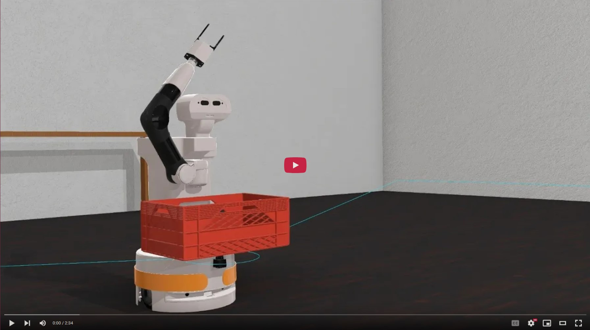

## About 
This is a project where a TIAGo robot has to collect the 10 yellow cubes throughout the store. The robot has to map the store, plan the paths it will take, and pick and place the cubes inside the red basket it is carrying. This was all done in the Webots simulation environment. 

## Video Demo

## Mapping
  ### Method: Autonomous

### Description
  - Autonomous mapping was achieved with LIDAR sensors that would record obstacle locations. The LIDAR sensors also helped tell where how the robot should move to continue to map the store, this is what made it autonomous. If the LIDAR detects obstacles too close to the right the robot would turn left and vice versa for the left. If the robot detects obstacles too close in front it simply rotates away. The mapping process is basically a drive obstacle avoidance mode that collects map data in the process.

## Path Planning
### Method: RRT* with path smoothing

### Description: 
  - For path plannning the RRT* algorithm from [PythonRobotics](https://github.com/AtsushiSakai/PythonRobotics) was used with some slight adjustments to make it work. The mapping process creates a numpy array of booleans dictating whether an obstacle exists in that space or not. The RRT* algorithm does not take in a grid map for obstacles but rather an obstacle list that takes an (x,y) coordinate and a radius to tell the size of the obstacle. To resolve this each occupied pixel coordinate was converted to world cordinates and given a small radius based on the resolution of the grid map. Each was then added to the obstacle list which made up the map for RRT*. However, the RRT algorithm only allowed for a square random sampling area, while a rectangular area was needed. So this was adjusted in the algorithm by simply adding two morre parameters and checks to the random area.

- For path smoothing, a greedy smoothing function was used. The function would simply try to cut out unnecessary points, while trying to avoid creating collisions. 

## Manipulation
### Method: Inverse Kinematics

### Description

## Computer Vision
### Method: Color Blob Detection with CV2

### Description

## Localization
### Method: GPS

### Description

### Odometry
- The code can be tested with odometry but it still has slight calculation errors and often crashes into obstacles. If you wish to test with odometry follow the comments in the PLAN and NAVIGATE modes and uncomment the block of code at the bottom highlighted as odometry.

## Libraries Used
- math
- numpy
- matplotlib
- ikpy
- cv2
- random
